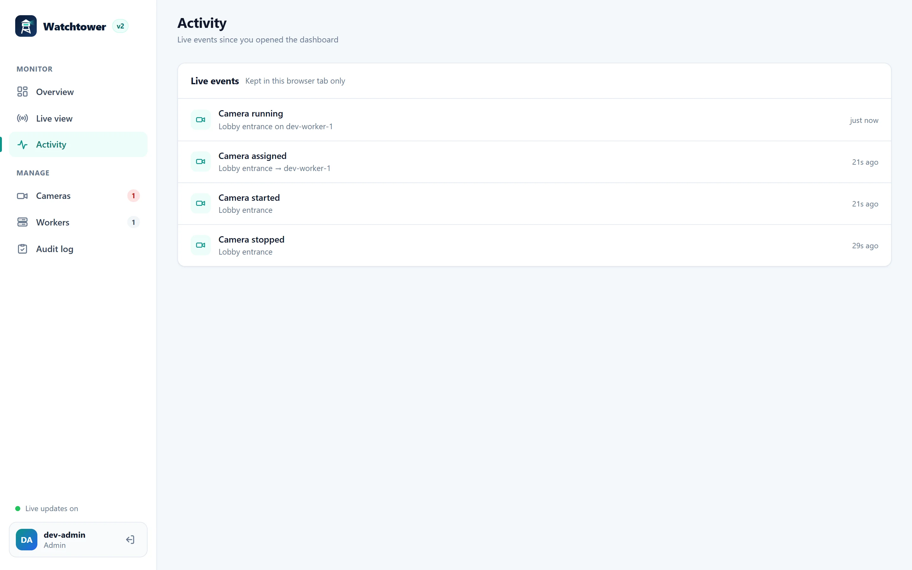
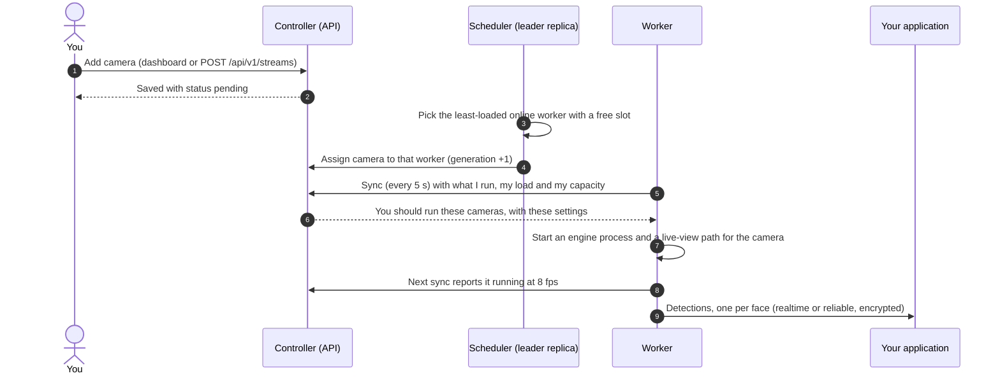

<p align="center">
  
</p>

<p align="center">
  <b>Real-time face detection across every camera, on workers you control.</b><br>
  Add cameras in a dashboard or through an API. Watchtower places each one on a worker, keeps it running through failures,<br>
  delivers every detection to your application, and lets your team watch any camera live in the browser.
</p>

<p align="center">
  <a href="https://naumanhsa.github.io/watchtower/"></a>
  <a href="pyproject.toml"></a>
  <a href="LICENSE"></a>
  <a href="https://github.com/NaumanHSA/watchtower/actions/workflows/ci.yml"></a>
  <a href="#-quick-start"></a>
</p>

<p align="center">
  
  
  
  
  
  
  
</p>

<p align="center">
  <a href="https://github.com/NaumanHSA/watchtower/stargazers"></a>
  <a href="https://github.com/NaumanHSA/watchtower/issues"></a>
  <a href="CHANGELOG.md"></a>
  <a href="https://github.com/NaumanHSA/watchtower/commits/main"></a>
  <a href="CONTRIBUTING.md"></a>
</p>

<p align="center">
  <a href="https://naumanhsa.github.io/watchtower/"><b>Documentation</b></a> ·
  <a href="#-quick-start"><b>Quick start</b></a> ·
  <a href="#-screenshots">Screenshots</a> ·
  <a href="#-how-it-works">How it works</a> ·
  <a href="#-deployment">Deployment</a> ·
  <a href="docs/api.md">API</a> ·
  <a href="docs/configuration.md">Configuration</a> ·
  <a href="#-documentation">All docs</a> ·
  <a href="CHANGELOG.md">Changelog</a> ·
  <a href="CONTRIBUTING.md">Contributing</a>
</p>

---

## 🧭 What this is

Watchtower runs **face detection on many camera streams across many machines** and sends each detection to your
application as it happens. It has three parts:

- **Controller**: the brain. It holds the list of cameras and workers, decides which worker runs which camera,
  serves the web dashboard and the REST API, and checks who is allowed to do what.
- **Workers**: the muscle. Each worker is a machine (a server, an edge box, a VM) that reads camera video, finds and
  tracks faces, and posts the results to your application. Add more workers to handle more cameras.
- **Your identity service**: who may sign in. Use your existing single sign-on (OpenID Connect: Keycloak, Entra ID,
  Auth0, Okta…), the small token server that ships in this repo, or your own service that answers
  [one simple request](docs/token-server.md).

You tell Watchtower *what* should run ("these 40 cameras"); it works out *where*, starts them, and keeps them
running. When a worker crashes or loses its network, its cameras move to healthy workers on their own. When the
controller is briefly down, workers keep analysing.

**Who it is for:** teams that need face detection on more cameras than one machine can handle, want results in
their own system (access control, analytics, search, alerting), and want to run everything on their own hardware,
including sites behind NAT or firewalls.

**What it is not:** Watchtower **detects and tracks** faces and hands you the best image of each one. It does not
recognise or identify people; if you need that, your application does it with the face crops Watchtower sends.
It is also not a video recorder (VMS/NVR). Read [docs/privacy.md](docs/privacy.md) before pointing it at people.

### Highlights

| | |
|---|---|
| 🌍 **Workers anywhere** | Workers only make outbound HTTPS calls. No open ports on the worker for control, so they run behind NAT, on edge boxes, in any cloud. |
| ♻️ **Self-healing fleet** | Leader-elected scheduler, leases, automatic failover, retries with backoff, draining for maintenance. |
| ⚡ **Two delivery modes** | Per camera: `realtime` (never late, drops stale results under pressure) or `reliable` (on-disk spool, in order, never lost). |
| 🔐 **Encrypted results** | Detections can be encrypted on the worker to a key only you hold (RSA-OAEP + AES-256-GCM). |
| 🪪 **Bring your own identity** | OIDC single sign-on with role mapping, a bundled token server, static tokens, or any HTTP token service. Roles: viewer, operator, admin. |
| 📺 **Live view in the browser** | WebRTC through MediaMTX, authorised per viewer, with TURN support for strict networks. |
| 🧾 **Audit and metrics** | Every change is recorded (who, what, when). Prometheus metrics and health probes on every service. |
| 🚢 **Easy to run** | One command for a full local stack; Compose files for production hosts; a Helm chart for Kubernetes. |

---

## ✨ What's new in 2.0

Version 2.0 is a rebuild of how the controller and workers cooperate. Highlights since 1.x:

- **Pull-based fleet.** The controller no longer calls into workers. Workers register once and then *sync* every
  few seconds: they report what they run and receive what they should run. Workers need no inbound control port.
- **A real scheduler.** A leader-elected scheduler places cameras on the least-loaded online worker, detects silent
  workers, moves their cameras, retries failed starts with backoff, and marks hopeless cameras `failed` instead of
  looping forever. Workers can be drained for maintenance.
- **Results that actually arrive**, in two modes you choose per camera (`realtime` or `reliable`), optionally
  encrypted end to end.
- **Pluggable sign-in.** OpenID Connect with dashboard single sign-on (PKCE), the bundled token server, static
  tokens, or your own token service; they can be chained. Proper roles: viewer, operator, admin, worker.
- **A new dashboard.** Overview with fleet health, camera management with search and filters, a live video wall,
  worker cards with load and delivery counters, live activity and an audit log.
- **Reference token server** in [`token-server/`](token-server/): issues and revokes tokens, holds the results
  keys, and can receive and decrypt results for you during development.
- **Production plumbing.** Non-root Docker images with health checks, Compose stacks, a Helm chart, Prometheus
  metrics, structured logs, rate-limited sign-in, request size limits, CI with tests, image builds, secret
  scanning and dependency audits.
- **Open source** under Apache 2.0, with documentation for every part.

The full list, including the 1.x bugs that were fixed, is in the [changelog](CHANGELOG.md). Coming from 1.x? See
[upgrading from v1](docs/upgrading-from-v1.md).

---

## 📸 Screenshots

<p align="center">
  
</p>

<table>
  <tr>
    <td width="50%"><p align="center"><b>Cameras</b>: search, filter, start, stop, edit</p></td>
    <td width="50%"><p align="center"><b>Live view</b>: WebRTC straight from the worker</p></td>
  </tr>
  <tr>
    <td width="50%"><p align="center"><b>Workers</b>: capacity, load and delivery</p></td>
    <td width="50%"><p align="center"><b>Add camera</b>: per-camera settings</p></td>
  </tr>
  <tr>
    <td width="50%"><p align="center"><b>Activity</b>: live events</p></td>
    <td width="50%"><p align="center"><b>Sign in</b>: SSO or token</p></td>
  </tr>
</table>

---

## 🚀 Quick start

Run the whole system on one machine in about five minutes. You need **Docker with Compose** (Docker Desktop on
Windows and macOS is fine).

```bash
git clone https://github.com/NaumanHSA/watchtower.git
cd watchtower
docker compose -f deploy/compose/dev/compose.yml up --build -d
```

1. Open **<http://localhost:7000>** and sign in with the token `dev-admin-token`.
2. Click **Add camera**, give it a name, and use the source URL `rtsp://camera:8554/cam1`. That is a fake camera
   the stack already runs (a moving test pattern).
3. Within a few seconds the camera shows **Running** on `dev-worker-1`. Open **Live view** and press play.
4. To see real detections, put any video with faces at `deploy/compose/dev/media/sample.mp4` and restart the feed:
   `docker compose -f deploy/compose/dev/compose.yml restart camera-feed`.
5. Results go to the bundled token server, which decrypts and saves them. Watch them arrive with
   `docker compose -f deploy/compose/dev/compose.yml logs -f token-server`.
6. Add a second worker with
   `docker compose -f deploy/compose/dev/compose.yml --profile second-worker up -d`, add cameras on
   `rtsp://camera:8554/cam2` and `cam3`, then kill a worker (`docker compose ... kill worker`) and watch its cameras
   move.

The full walkthrough, with what to expect at every step, is
[Try it on your computer](https://naumanhsa.github.io/watchtower/quick-start/) in the manual.

What the dev stack runs:

| Service | Address | Notes |
|---|---|---|
| Dashboard and API | <http://localhost:7000> | Tokens: `dev-admin-token`, `dev-viewer-token` (read-only) |
| Token server | <http://localhost:9000> | Issues and checks tokens, receives and decrypts results |
| Worker health and metrics | <http://localhost:8081/readyz> | One worker, `dev-worker-1`, with 4 camera slots (`dev-worker-2` on 8082 with the `second-worker` profile) |
| WebRTC (live view) | `localhost:8889`, `8189/udp` | MediaMTX on the worker |
| Fake camera | `rtsp://camera:8554/cam1`, `cam2`, `cam3` | Reachable from inside the stack only |

Stop everything with `docker compose -f deploy/compose/dev/compose.yml --profile second-worker down` (add `-v` to
also delete the data).

> [!WARNING]
> The dev stack uses fixed, public tokens and plain HTTP. It is for trying things out on one machine. To deploy for
> real, follow [docs/deployment.md](docs/deployment.md).

### Try the API

Everything the dashboard does goes through the same REST API:

```bash
TOKEN=dev-admin-token

# add a camera (the Idempotency-Key makes retries safe)
curl -s -X POST http://localhost:7000/api/v1/streams \
  -H "Authorization: Bearer $TOKEN" -H "Content-Type: application/json" \
  -H "Idempotency-Key: $(uuidgen)" \
  -d '{"name": "Lobby", "location": "Building A", "source_url": "rtsp://camera:8554/cam1",
       "config": {"fps": 8, "delivery_mode": "reliable"}}'

curl -s -H "Authorization: Bearer $TOKEN" http://localhost:7000/api/v1/streams   # where is it running?
curl -s -H "Authorization: Bearer $TOKEN" http://localhost:7000/api/v1/workers   # who is in the fleet?
curl -s -H "Authorization: Bearer $TOKEN" http://localhost:7000/api/v1/stats     # totals
```

---

## 🏗️ How it works

<p align="center">
  
</p>

The key idea: **the controller never calls a worker.** Every worker opens the connection itself, so the
controller doesn't need to know where workers are or be able to reach them.

### Life of a camera



1. **You add a camera.** The controller saves it as `pending`. Nothing has run yet.
2. **The scheduler places it.** One controller replica holds a lease in MongoDB and acts as the scheduler. Every
   couple of seconds it looks for cameras without a worker and picks the **online, non-draining worker with the
   most free slots** (a worker's slots are its `MAX_STREAMS` setting). The assignment gets a new *generation*
   number, so stale reports from an older assignment are ignored.
3. **The worker learns on its next sync.** At most a few seconds later the worker asks "what should I run?", sees
   the new camera, starts an engine process for it and a MediaMTX path for live view, and reports `starting` and
   then `running`.
4. **Results flow.** The engine reads frames, detects faces with YuNet, tracks each face across frames and, at the
   interval you set, sends the best snapshot of each face to your results URL.

### How a worker finds and talks to the controller

A worker is configured with just two things: **`CONTROLLER_URL`** (where the controller is) and
**`WATCHTOWER_TOKEN`** (a token with the `worker` role).

- **Register (once).** The worker calls `POST /api/v1/workers/register` with its token, name, version and
  capacity. The controller answers with a `worker_id` and a private `worker_secret`. The worker saves both in
  `STATE_DIR/identity.json`, so after a restart it is the same worker.
- **Sync (every 5 seconds).** `POST /api/v1/workers/{id}/sync` carries the worker's status: which cameras it runs
  and how each is doing (fps, errors), CPU and memory load, delivery counters. The answer is the full list of
  cameras it *should* run, plus the sync interval and lease. The worker starts and stops engines to match.
- **If the controller is unreachable**, the worker retries with backoff and keeps its cameras running
  (`ON_LEASE_EXPIRY=keep_running`, the default). If its secret is rejected it registers again; if its token is
  revoked it stops everything.

### What the controller knows about each worker

Everything comes from the worker's own register and sync calls:

| Field | Where it comes from | Used for |
|---|---|---|
| `worker_id`, `name`, `version`, host info | Registration | Display, audit |
| Capacity (`max_streams`) | Registration and every sync | How many cameras it may get |
| Load (CPU %, memory %) | Every sync | Dashboard, operators' decisions |
| Running cameras and their status (fps, errors) | Every sync | Camera status, retries, failover |
| Delivery counters (sent, dropped, failed, queued) | Every sync | Dashboard, metrics |
| Live view address (`PUBLIC_WEBRTC_URL`) | Registration | Telling browsers where to play from |
| `last_seen` → state `online` / `suspect` / `offline` | Time of the last sync | Failover |
| `draining` | An operator, in the dashboard or API | Moving cameras off before maintenance |

### When things go wrong

| What happens | What Watchtower does |
|---|---|
| A worker crashes, loses power or network | After missing syncs for about 15 s it is `suspect`; after its lease (60 s + 15 s grace) it is `offline` and its cameras move to other workers. |
| An engine process crashes | The worker restarts it with backoff (5, 15, 30, 60 s); after `MAX_ENGINE_RESTARTS` it reports `error` and the scheduler tries another worker. |
| A camera can't be opened | The camera shows `reconnecting` while the engine keeps trying; repeated failed starts back off (10 s doubling, up to 10 min) and end in `failed` after `MAX_START_ATTEMPTS`. Press **Retry** when it is fixed. |
| The controller (or MongoDB) is down | Workers keep running what they have and keep delivering results. When it is back, everything reconciles on the next sync. |
| The scheduler replica dies | Another controller replica takes over its lease and continues. |
| A worker needs maintenance | **Drain** it: its cameras move away and it gets no new ones. Undrain to bring it back. |
| Your results endpoint is down | `realtime` drops stale results so the newest ones arrive first when it returns; `reliable` keeps them on disk (up to `SPOOL_MAX_MB`) and sends them in order. |

The full design, including leases, generations and the exact protocol, is in
[docs/architecture.md](docs/architecture.md).

---

## 🧩 Components

| Path | What it is | Built with |
|---|---|---|
| [`controller/`](controller/) | Control plane: REST API, scheduler, live events, dashboard, audit log | FastAPI, MongoDB, optional Redis |
| [`worker/`](worker/) | Worker agent, detection engines, result delivery, live-view auth hook | OpenCV, ONNX Runtime, MediaMTX |
| [`token-server/`](token-server/) | Reference token server: tokens with roles and expiry, results keys, optional results receiver | FastAPI |
| [`packages/contracts/`](packages/contracts/) | The protocol models and result encryption, shared by all of the above | Pydantic, cryptography |
| [`deploy/`](deploy/) | Compose stacks (dev, control plane, worker host), the Helm chart, MediaMTX config | Docker, Helm |
| [`docs/`](docs/) | Guides for architecture, deployment, configuration, API, results, privacy | Markdown |

The dashboard is plain HTML, CSS and JavaScript served by the controller: no build step and no third-party code,
so it works air-gapped and under a strict Content Security Policy.

---

## 🔐 Sign-in and roles

Pick an identity provider with `AUTH_PROVIDER` on the controller:

| Provider | Use it when | Setup |
|---|---|---|
| `oidc` | You have single sign-on (Keycloak, Entra ID, Auth0, Okta, Google…) | Set `OIDC_ISSUER`, `OIDC_AUDIENCE`, the role claim and optional role mapping; `OIDC_CLIENT_ID` enables the **Sign in with SSO** button. |
| `http` | You use the bundled token server, or your own token service | Set `TOKEN_SERVER_URL`. The [contract](docs/token-server.md) is one GET request that returns the token's role. |
| `static` | Small or air-gapped installs | Tokens in `STATIC_TOKENS` or a file, as `role:token`. |
| `oidc,static` | People use SSO, machines use tokens | Providers are tried in order. |
| `none` | Local experiments only | Also requires `ALLOW_NO_AUTH=true`. |

| Role | Can |
|---|---|
| `viewer` | See cameras, workers and stats, watch live video |
| `operator` | Everything a viewer can, plus add, edit, start, stop and delete cameras, drain workers |
| `admin` | Everything, plus forget workers and read the audit log |
| `worker` | Only register and sync (for worker machines, not people) |

Failed sign-ins are rate-limited per address, and every change is written to the audit log with who made it.

---

## 📦 Results and delivery

Each detection is one HTTP `POST` to your results URL (set per camera, or a default on the controller). A result is
sent **once per face per interval**, not once per frame, and carries the best snapshot so far:

```json
{
  "ok": true,
  "received": {
    "eventId": "1c9e0c7f3f8f4a0e9d5d8a0a6c3b2f11",
    "streamId": "7a51dab7-9beb-4478-9ba2-d2e88383b3b7",
    "streamName": "Lobby",
    "workerId": "w-05f9f953aea8",
    "trackId": "17",
    "timestamp": "2026-10-15T11:56:13.412Z",
    "bbox": {"xywh": {"x": 412, "y": 281, "w": 175, "h": 208}},
    "detectorParamsCore": {"endOfTrack": false, "quality": 0.9961, "trackDurationSeconds": 2.187},
    "photo": "<base64 JPEG of the full frame, or null>",
    "normalized": "<base64 JPEG of the face crop>"
  }
}
```

| Mode | Promise | Good for |
|---|---|---|
| `realtime` (default) | Never late: a small in-memory queue; results older than `MAX_RESULT_AGE_MS` are dropped | Live alerts, door access, dashboards |
| `reliable` | Never lost: results are spooled on disk and sent in order, retried until accepted | Analytics, search, compliance records |

**Encryption.** When your token server provides a public key, workers encrypt every result before it is queued or
spooled (RSA-OAEP-256 wrapping an AES-256-GCM key). Only the holder of the private key can read results, even if
the network or the spool is compromised. Decrypting takes a few lines; see [docs/results.md](docs/results.md).

---

## 🚢 Deployment

| Target | How | Guide |
|---|---|---|
| **One machine, to try it** | `deploy/compose/dev` | [Quick start](#-quick-start) |
| **Production with Docker** | Control plane (controller, MongoDB, token server, Caddy for TLS) on one host with `deploy/compose/controller`; any number of worker hosts with `deploy/compose/worker` | [docs/deployment.md](docs/deployment.md) |
| **Kubernetes** | Helm chart in `deploy/helm/watchtower` (controller, workers, optional token server, ingress) | [docs/kubernetes.md](docs/kubernetes.md) |

A production control plane, in short:

```bash
cd deploy/compose/controller
cp .env.example .env                                   # set your domain, Mongo, auth provider
docker compose --profile token-server --profile tls up -d --build
docker compose exec token-server watchtower-token-server issue --role admin  --subject you
docker compose exec token-server watchtower-token-server issue --role worker --subject site-a
```

And on each worker host:

```bash
cd deploy/compose/worker
cp .env.example .env              # CONTROLLER_URL, WATCHTOWER_TOKEN, MAX_STREAMS, PUBLIC_WEBRTC_URL
docker compose up -d --build
```

On Kubernetes:

```bash
helm install wt deploy/helm/watchtower \
  --set controller.mongoUri=mongodb://mongo.db.svc:27017 \
  --set worker.tokenSecret.name=wt-worker \
  --set tokenServer.enabled=true \
  --set controller.ingress.enabled=true --set controller.ingress.host=watchtower.example.com
```

**Sizing.** As a starting point, one 720p camera at the defaults (8 fps, 320 px detector) used about 6% of one x86
core and 130 MB of RAM. Set each worker's `MAX_STREAMS` to what its hardware handles, and add workers to grow.
Multi-arch images (amd64, arm64) are published to GitHub Container Registry on each release tag.

---

## ⚙️ Configuration

Every service is configured with environment variables. The ones most people touch:

| Service | Setting | Default | What it does |
|---|---|---|---|
| Controller | `MONGO_URI` | `mongodb://localhost:27017` | Where state lives |
| Controller | `AUTH_PROVIDER` | `http` | `oidc`, `http`, `static`, a chain like `oidc,static`, or `none` |
| Controller | `RESULTS_URL` | not set | Default results URL for cameras that don't set one |
| Controller | `SYNC_INTERVAL_MS` | `5000` | How often workers sync |
| Controller | `LEASE_SECONDS` | `60` | How long a silent worker keeps its cameras |
| Controller | `REDIS_URL` | not set | Needed with more than one controller replica, for live events |
| Worker | `CONTROLLER_URL` | `http://localhost:7000` | Where the controller is |
| Worker | `WATCHTOWER_TOKEN` | not set | A token with the `worker` role |
| Worker | `MAX_STREAMS` | `2` | Camera slots on this worker |
| Worker | `PUBLIC_WEBRTC_URL` | not set | Address browsers use for live view from this worker |
| Worker | `DELIVERY_MODE` | `realtime` | Default delivery mode |
| Worker | `REQUIRE_ENCRYPTION` | `false` | Never send results in plaintext |

Per camera you can set fps, detector size, minimum confidence, result interval, which snapshot to send (best,
first, last), whether to include the full frame, delivery mode, results URL and free-form metadata.

The complete reference is [docs/configuration.md](docs/configuration.md).

---

## 🔌 API

A REST API under `/api/v1` with bearer tokens, plus a WebSocket for live events.

| | Endpoint | Role |
|---|---|---|
| Cameras | `GET/POST /streams`, `GET/PATCH/DELETE /streams/{id}`, `POST /streams/{id}/start`, `/stop`, `GET /streams/{id}/view` | viewer / operator |
| Workers | `GET /workers`, `GET /workers/{id}`, `POST /workers/{id}/drain`, `DELETE /workers/{id}` | viewer / operator / admin |
| System | `GET /me`, `GET /stats`, `GET /audit`, `WS /events` | viewer / admin |
| Probes | `GET /livez`, `GET /readyz`, `GET /metrics` | none / viewer |

Interactive docs are served at `/docs` on the controller. Details, examples and event formats:
[docs/api.md](docs/api.md).

---

## 📈 Observability

- **Health:** `/livez` and `/readyz` on the controller (readiness checks MongoDB and reports whether the replica is
  the scheduler) and on every worker (readiness means it has synced with the controller recently).
- **Metrics:** Prometheus at `/metrics`. The controller reports workers by state, cameras by status, capacity,
  cameras per worker, which replica is the scheduler, dashboard connections and failed sign-ins. Workers report
  sync health, per-camera up, fps and restarts, results sent, dropped and failed, and the spool size.
- **Logs:** plain text, or one JSON object per line with `LOG_FORMAT=json`.
- **Audit log:** every change, with who made it, kept for `AUDIT_RETENTION_DAYS` (dashboard **Audit log** page,
  `GET /api/v1/audit`).
- **Live events:** the dashboard's **Activity** page, or subscribe to `WS /api/v1/events` yourself.

---

## 🛡️ Security and privacy

- Workers authenticate with a role-scoped token, then a per-worker secret; a revoked token stops a worker.
- Live video is authorised per viewer: MediaMTX asks the worker, which asks the controller.
- Camera passwords are stored but never returned by the API or shown in the dashboard.
- Results can be encrypted end to end; `REQUIRE_ENCRYPTION=true` refuses to send plaintext.
- The dashboard uses a strict Content Security Policy and inserts no untrusted HTML.
- Images run as non-root; CI scans for leaked secrets and vulnerable dependencies.

Face images are personal data in most places. [docs/privacy.md](docs/privacy.md) lists what is stored and sent and
how to minimise it (crop-only results, short retention, encryption). To report a vulnerability, follow
[SECURITY.md](SECURITY.md); please don't open a public issue.

---

## 🧪 Development and testing

The repo is a [uv](https://docs.astral.sh/uv/) workspace (Python 3.12 recommended, 3.11 supported):

```bash
uv sync                          # install everything
uv run ruff check .              # lint
uv run pytest                    # tests; controller tests need MongoDB (TEST_MONGO_URI or localhost:27018)

# run a piece on its own
uv run watchtower-controller
uv run watchtower-worker
uv run watchtower-token-server
```

A throwaway MongoDB for the tests: `docker run -d --rm -p 27018:27017 mongo:7`.

Preview the documentation site while you edit `docs/` (MkDocs with Material, live reload):

```bash
uv run --only-group docs mkdocs serve      # http://127.0.0.1:8000/watchtower/
uv run --only-group docs mkdocs build --strict   # what CI runs: fails on broken links
```

The dashboard lives in [`controller/watchtower_controller/static/`](controller/watchtower_controller/static/) and
needs no build: edit and reload. More in [docs/development.md](docs/development.md).

---

## 📚 Documentation

The complete manual lives in [`docs/`](docs/) and is published as a website at
**<https://naumanhsa.github.io/watchtower/>**, rebuilt from `main` on every change. New to Watchtower? Read the
*Get started* pages in order.

| Section | Guide | What's in it |
|---|---|---|
| Get started | [How Watchtower works](docs/how-it-works.md) | The pieces, the life of a camera, what happens when things fail |
| | [Try it on your computer](docs/quick-start.md) | A guided tour of the local setup: cameras, live view, results, a second worker, a crash |
| | [A tour of the dashboard](docs/dashboard.md) | Every page and button, and what each role sees |
| User guide | [Cameras](docs/cameras.md) | Connecting real cameras, every camera setting, recipes, statuses |
| | [Workers](docs/workers.md) | Adding a worker step by step, sizing, live view and HTTPS, maintenance |
| | [Receiving results](docs/results.md) | Writing a receiver, the result format, delivery modes, encryption |
| | [Users and sign-in](docs/access.md) | Roles, issuing and revoking tokens, single sign-on |
| Deploy | [Deploying to production](docs/deployment.md) | A step-by-step installation with HTTPS, and a checklist |
| | [Running on Kubernetes](docs/kubernetes.md) | The Helm chart, step by step |
| | [Monitoring and maintenance](docs/operations.md) | Health checks, metrics and alert rules, backups, upgrades |
| Reference | [Configuration](docs/configuration.md) | Every setting of every service, grouped by purpose |
| | [REST API](docs/api.md) | Endpoints, roles, live events, errors |
| | [Token servers](docs/token-server.md) | The sign-in contract, writing your own, the bundled server |
| | [Architecture](docs/architecture.md) | The pull protocol, scheduling, leases and generations in depth |
| Help | [Troubleshooting](docs/troubleshooting.md) | Problems by symptom, and how to fix them |
| | [Privacy](docs/privacy.md) | What is stored and sent, and how to minimise it |
| Project | [Development](docs/development.md), [Upgrading from 1.x](docs/upgrading-from-v1.md) | Working on the code; moving from version 1 |

---

## 🗺️ Roadmap

Ideas for after 2.0, roughly in order. Discussion and pull requests are welcome.

- GPU detectors (CUDA, OpenVINO) and per-worker detector choice
- Placement hints: pin cameras to sites or labels, keep a camera near its network
- Webhooks for fleet events (worker offline, camera failed)
- Result sinks beyond HTTP (Kafka, MQTT, S3)
- Multi-tenant organisations and per-team camera scopes

---

## 🤝 Contributing

Bug reports, ideas and pull requests are welcome. Please read [CONTRIBUTING.md](CONTRIBUTING.md) first; it covers
setup, tests and the pull request checklist.

## 🙏 Acknowledgements

Watchtower builds on excellent open-source work: [YuNet](https://github.com/opencv/opencv_zoo/tree/main/models/face_detection_yunet)
from the OpenCV Model Zoo, [OpenCV](https://opencv.org/), [ONNX Runtime](https://onnxruntime.ai/),
[MediaMTX](https://github.com/bluenviron/mediamtx), [FastAPI](https://fastapi.tiangolo.com/) and
[MongoDB](https://www.mongodb.com/). Licenses are listed in [THIRD_PARTY_NOTICES.md](THIRD_PARTY_NOTICES.md).

## 📄 License

Watchtower is open source under the [Apache License 2.0](LICENSE). Copyright 2026 NaumanHSA and the Watchtower
contributors.
