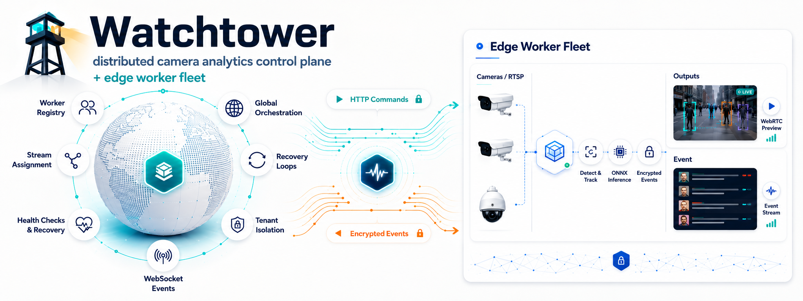

Watchtower runs face detection on many camera streams across many machines, and
sends each detection to your application as it happens. You add cameras in a web
dashboard or through the API; a central **controller** decides which **worker**
processes each camera, moves cameras off workers that fail, and lets people watch
any camera live in the browser.

- **Pull-based fleet.** Workers only make outbound connections, so they can run behind
  NAT, on edge boxes, anywhere that can reach the controller. No inbound control port.
- **Self-healing.** A worker that dies loses its cameras to healthy workers within a
  lease (about 75 seconds); a worker that keeps running while the controller is down
  keeps analysing. Crashed engines restart with backoff.
- **Your choice of delivery.** Per camera: `realtime` (never late, drops stale results
  under pressure) or `reliable` (spooled on disk, delivered in order, never lost).
- **Encrypted results.** Detections can be encrypted to a key only you hold
  (RSA-OAEP + AES-256-GCM).
- **Bring your own identity.** Sign in through your identity provider (OpenID Connect:
  Keycloak, Entra ID, Auth0, Okta…), use the token server in this repo, or point the
  controller at your own service that answers one small [contract](docs/token-server.md).
- **Live view.** WebRTC through [MediaMTX](https://github.com/bluenviron/mediamtx),
  authorised per viewer.

## Quick start

You need Docker with Compose.

```bash
git clone https://github.com/NaumanHSA/watchtower.git
cd watchtower
docker compose -f deploy/compose/dev/compose.yml up --build
```

Open <http://localhost:7000> and sign in with `dev-admin-token`. Click **Add camera**
and use `rtsp://camera:8554/cam1`, a fake camera the stack already runs. To see
detections, put any video with faces at `deploy/compose/dev/media/sample.mp4` and
restart the `camera-feed` service. Results are decrypted by the bundled token server
and saved in its volume (`docker compose -f deploy/compose/dev/compose.yml logs -f token-server`).

The dev stack uses fixed tokens and is for one machine only. To deploy for real, see
[docs/deployment.md](docs/deployment.md).

## How it fits together

```
                     ┌────────────────────────────┐        ┌───────────────┐
 dashboard / API ──► │ controller (1..N replicas)  │ ◄────► │ token server  │ yours, or token-server/
 (bearer token)      │ REST · scheduler · events   │        └───────────────┘
                     └─────────────▲──────────────┘ ◄── MongoDB
                                   │ HTTPS, opened by the worker:
                                   │ register once, then sync every few seconds
                     ┌─────────────┴──────────────┐
                     │ worker host                 │ ──► your results URL
                     │  worker: one engine per     │     (realtime | reliable)
                     │  camera, YuNet on ONNX       │
                     │  MediaMTX: camera re-stream │ ──► viewers (WebRTC)
                     └─────────────▲──────────────┘
                                   │ RTSP
                                cameras
```

Each sync, the worker reports what it is running and receives what it *should* run;
it then starts and stops engine processes to match. The full design, including
failure handling, is in [docs/architecture.md](docs/architecture.md).

## Repository

| Path | What it is |
|---|---|
| [controller/](controller/) | Control plane: API, scheduler, dashboard (FastAPI, MongoDB) |
| [worker/](worker/) | Worker agent, detection engine, result delivery (OpenCV, onnxruntime) |
| [token-server/](token-server/) | Reference token server: issues and verifies tokens, holds result keys |
| [packages/contracts/](packages/contracts/) | Protocol models shared by all of the above |
| [deploy/](deploy/) | Docker Compose stacks, the Helm chart, the MediaMTX configuration |
| [docs/](docs/) | Architecture, configuration, API, results format, operations |

## Documentation

- [Architecture](docs/architecture.md): the pull protocol, scheduling, leases, failure modes
- [Deployment](docs/deployment.md): production Compose stacks, TLS, networking, scaling
- [Configuration](docs/configuration.md): every setting of every service
- [API](docs/api.md): REST endpoints, roles, live events
- [Token servers](docs/token-server.md): the contract, and using your own identity service
- [Results](docs/results.md): payload format, encryption, delivery modes, decrypting
- [Privacy](docs/privacy.md): what is stored and sent, and how to minimise it
- [Development](docs/development.md): working on the code
- [Upgrading from 1.x](docs/upgrading-from-v1.md)

## Contributing and security

See [CONTRIBUTING.md](CONTRIBUTING.md). Please report vulnerabilities privately as
described in [SECURITY.md](SECURITY.md), not in public issues.

## License

Watchtower is open source under the [Apache License 2.0](LICENSE). Third-party
components and their licenses are listed in [THIRD_PARTY_NOTICES.md](THIRD_PARTY_NOTICES.md).
