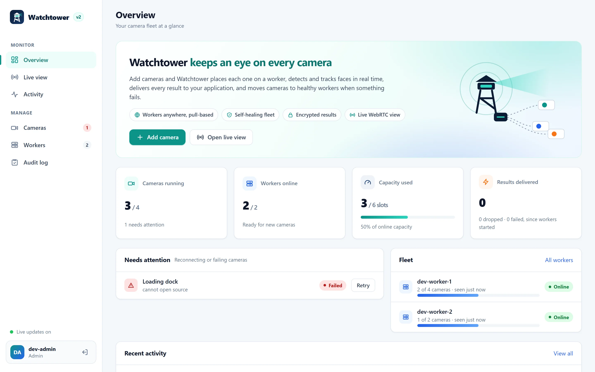
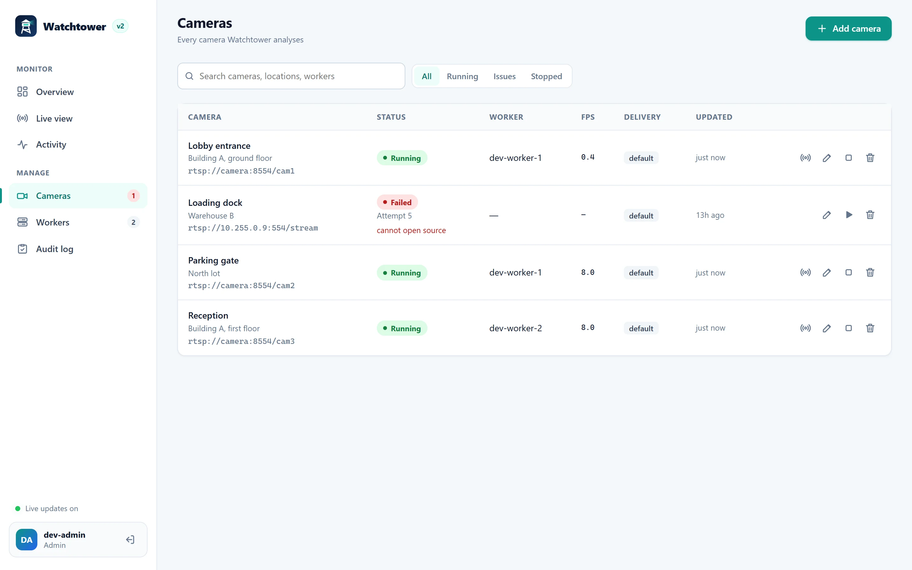
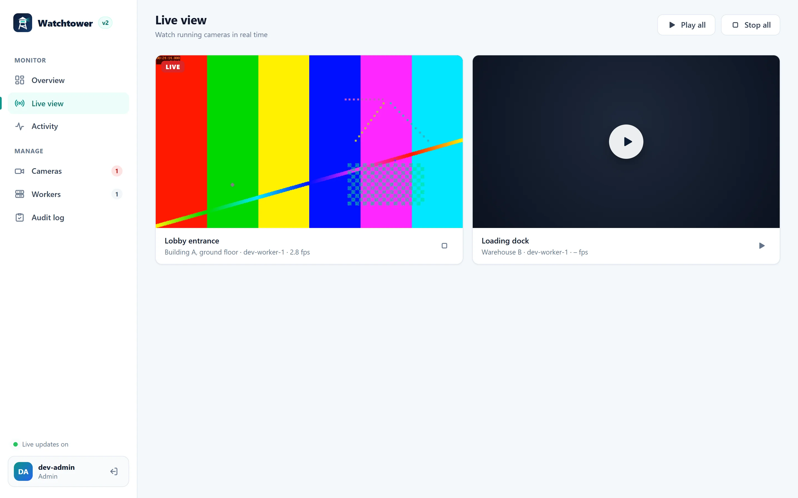
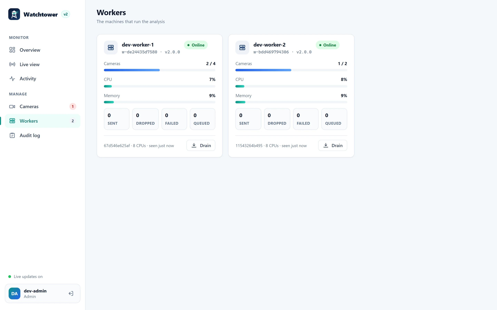
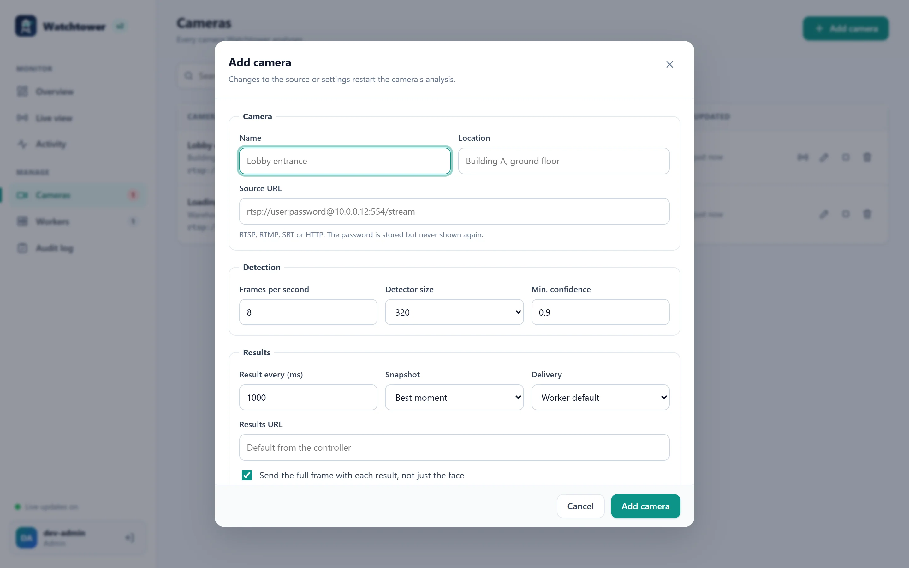
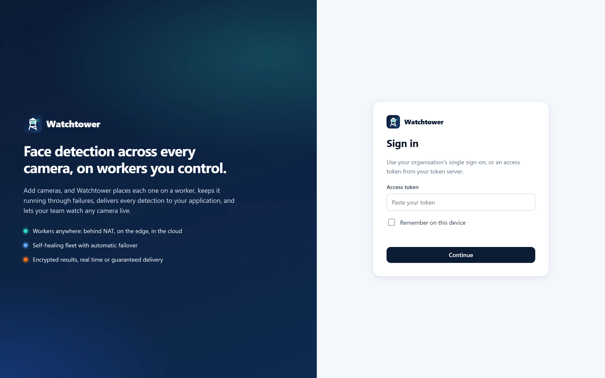
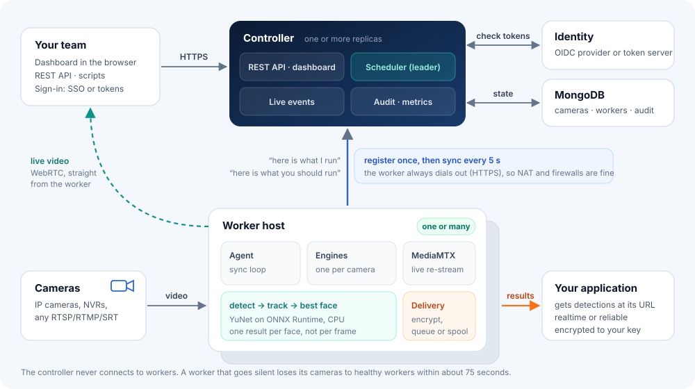
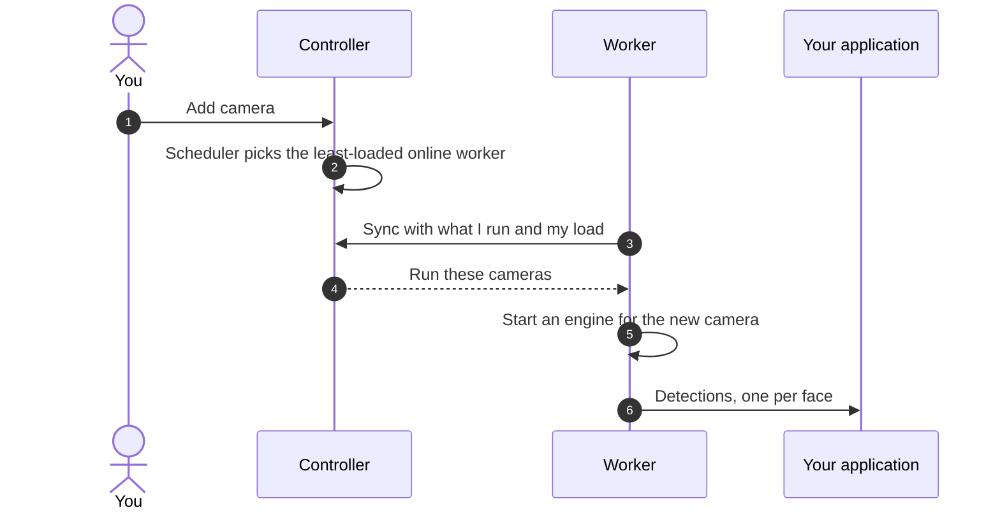

<div class="wt-hero" markdown>

# Watchtower <span>keeps an eye on every camera</span>

Watchtower runs **face detection on many camera streams across many machines** and sends each detection to your
application as it happens. Add cameras in a dashboard or through the API; Watchtower places each one on a worker,
keeps it running through failures, delivers every result, and lets your team watch any camera live.

[Get started](#quick-start){ .md-button .md-button--primary }
[How it works](architecture.md){ .md-button }
[View on GitHub](https://github.com/NaumanHSA/watchtower){ .md-button }

</div>

## What it does

<div class="grid cards" markdown>

-   :material-earth:{ .lg .middle } **Workers anywhere**

    ---

    Workers only make outbound HTTPS calls, so they run behind NAT, on edge boxes and in any cloud. No inbound
    control port.

    [:octicons-arrow-right-24: The pull protocol](architecture.md)

-   :material-autorenew:{ .lg .middle } **Self-healing fleet**

    ---

    A leader-elected scheduler places cameras, notices silent workers and moves their cameras, retries with
    backoff and supports draining for maintenance.

    [:octicons-arrow-right-24: Failure handling](architecture.md#failure-handling)

-   :material-lightning-bolt:{ .lg .middle } **Real time or never lost**

    ---

    Choose per camera: `realtime` drops stale results to stay current; `reliable` spools on disk and delivers
    every result in order.

    [:octicons-arrow-right-24: Delivery modes](results.md#delivery-modes)

-   :material-lock:{ .lg .middle } **Encrypted results**

    ---

    Workers encrypt each result to a key only you hold (RSA-OAEP + AES-256-GCM) before it is queued or stored.

    [:octicons-arrow-right-24: Results and encryption](results.md#encryption)

-   :material-card-account-details:{ .lg .middle } **Bring your own identity**

    ---

    OpenID Connect single sign-on with role mapping, the bundled token server, static tokens, or your own token
    service. Roles: viewer, operator, admin.

    [:octicons-arrow-right-24: Sign-in options](token-server.md)

-   :material-access-point:{ .lg .middle } **Live view in the browser**

    ---

    WebRTC straight from the worker through MediaMTX, authorised per viewer, with TURN relays for strict
    networks.

    [:octicons-arrow-right-24: Networking](deployment.md#network)

</div>

Watchtower **detects and tracks** faces and hands you the best image of each one. It does not identify people and
it is not a video recorder. Please read [Privacy](privacy.md) before pointing it at people.

## See it

=== "Overview"

    <div class="wt-shot" markdown></div>

=== "Cameras"

    <div class="wt-shot" markdown></div>

=== "Live view"

    <div class="wt-shot" markdown></div>

=== "Workers"

    <div class="wt-shot" markdown></div>

=== "Add camera"

    <div class="wt-shot" markdown></div>

=== "Sign in"

    <div class="wt-shot" markdown></div>

## How it fits together



The **controller** holds the list of cameras and workers, runs the scheduler, and serves the dashboard and API.
**Workers** register once and then sync every few seconds: they report what they run and receive what they should
run. The controller never connects to a worker, which is why workers can live anywhere.



Read the full design in [Architecture](architecture.md).

## Quick start

Run everything on one machine with Docker Compose:

```bash
git clone https://github.com/NaumanHSA/watchtower.git
cd watchtower
docker compose -f deploy/compose/dev/compose.yml up --build -d
```

1. Open <http://localhost:7000> and sign in with the token `dev-admin-token`.
2. Click **Add camera** and use the source URL `rtsp://camera:8554/cam1`, a fake camera the stack already runs.
3. Within a few seconds it shows **Running**. Open **Live view** and press play.
4. For real detections, put a video with faces at `deploy/compose/dev/media/sample.mp4` and run
   `docker compose -f deploy/compose/dev/compose.yml restart camera-feed`.

!!! warning "For trying things out only"

    The dev stack uses fixed, public tokens and plain HTTP. To run Watchtower for real, follow
    [Deployment](deployment.md).

## Where next

| If you want to… | Read |
|---|---|
| Understand the protocol, scheduling and failure handling | [Architecture](architecture.md) |
| Run it in production with Docker or Kubernetes | [Deployment](deployment.md) |
| Look up a setting | [Configuration](configuration.md) |
| Connect your identity provider or write a token service | [Token servers and sign-in](token-server.md) |
| Receive and decrypt results | [Results and delivery](results.md) |
| Automate with the REST API | [REST API](api.md) |
| Work on the code | [Development](development.md) |
| Move from 1.x | [Upgrading from 1.x](upgrading-from-v1.md) |
